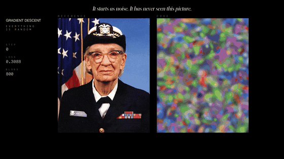
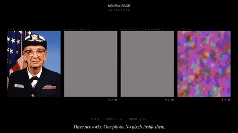
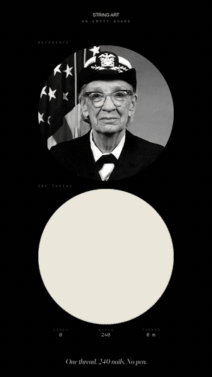
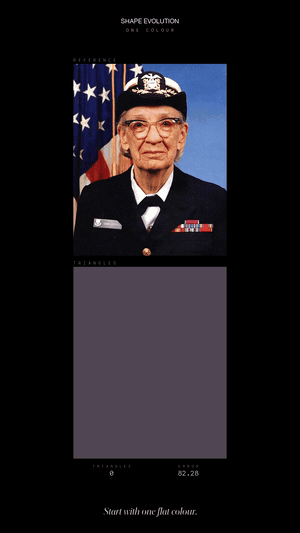
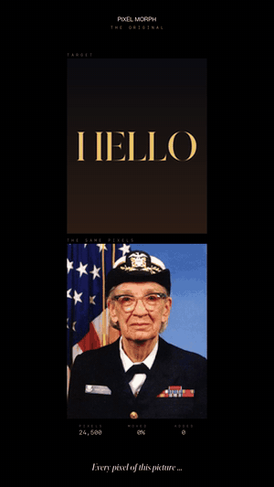
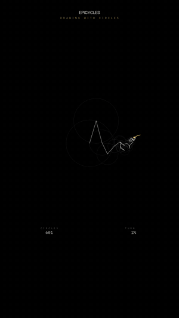

# algo-films

**Short films where the process is the content.** A photo goes in, an algorithm visibly works its way toward it, and every frame of the video is the real computation. No image model, no video model, no API key, no credits: just numpy, PyTorch, OpenCV and ffmpeg on a laptop.

<p align="center">
  
</p>

Six tools, one command each. Every one renders a finished MP4 (16:9, 9:16, 1:1 or 4:5) with a HUD of the real numbers, a "which one is the photo?" beat, a title card and a generated soundtrack that follows the error curve.

| | Tool | What you watch | Laptop time* |
|---|---|---|---|
|  | `splat` | 20,000 soft blobs start as noise and learn a photo by gradient descent (Adam, L1 + SSIM, error-driven densification), then a zoom proves it is all blobs | ~8-15 min |
|  | `neural` | Three neural networks (plain ReLU, Fourier features, SIREN) race to memorise the same photo; at 10x zoom the photo turns into pixels while the networks keep painting | ~8 min |
|  | `strings` | String art: one thread wound around 240 nails redraws the face, 3,500 straight lines; the nail order is saved so you can build it for real | ~25 s |
|  | `shapes` | 300 translucent triangles found by random guesses + hill climbing, each one kept only if it lowers the error | ~20 s |
|  | `morph` | Every pixel of the photo flies to a new place and together they spell a word (or become another photo). Nothing added, nothing recoloured | ~15 s |
|  | `epicycles` | 600 spinning circles (a Fourier series) draw a word, a logo or a photo's outline with one pen, then the drawing sharpens as circles are added | ~15 s |

\*Measured on an M3 MacBook (16 GB) with the default settings. `splat` and `neural` use the Apple GPU (MPS), CUDA or the CPU.

## Quick start

Needs Python 3.10+ and `ffmpeg` on your PATH.

```bash
git clone https://github.com/FBeraZulaloglu/algo-films && cd algo-films
python3 -m pip install -r requirements.txt
python3 -m algofilms strings -o strings.mp4                 # uses a public-domain sample portrait
python3 -m algofilms splat my-photo.jpg -o splat.mp4 --format 9:16
python3 -m algofilms epicycles --text "Your Name" -o epi.mp4
python3 -m algofilms morph my-photo.jpg --text "HELLO" -o morph.mp4
python3 -m algofilms neural my-photo.jpg -o race.mp4 --format 16:9
python3 -m algofilms shapes my-photo.jpg -o shapes.mp4
```

Common options: `--format 16:9|9:16|1:1|4:5`, `--seconds 20`, `--fps 30`, `--accent "#e63946"`, `--focus 0.5,0.4` (crop centre), `--no-sound`. Each tool has its own knobs (`--steps`, `--blobs`, `--nails`, `--lines`, `--circles`, `--shapes`, `--grid`, `--target`); see `python3 -m algofilms <tool> -h`.

`scripts/render_demos.sh` renders every demo one after another and cuts the README GIFs.

## Why this format works

It is the shape of "Gradient Descent for Orchestra" and [Gradient Descent for a Face](https://github.com/sirioberati/gradient-descent-for-a-face), which inspired this repo:

1. **An obvious wrong start**: noise, an empty board, one flat colour.
2. **A real process that measurably improves**, with its real numbers on screen (step, loss, blobs, lines).
3. **A payoff you have to wait for**: side by side with the photo ("which one is the photo?"), then a zoom that proves what it is made of.
4. **One honest sentence** on the title card about what was learned and what was not.

The film's clock maps time to steps with a slow start (`core.schedule`), so the first chaotic steps get screen time and the slow polish goes fast.

## How each one works

- **splat**: a hand-written differentiable 2D Gaussian rasteriser in PyTorch. Each blob is 9 numbers (position, log-size, angle, colour, strength). Blobs are splatted into small patches bucketed by size; blobs too big for the largest patch are painted on a coarser grid and upsampled, so nothing gets cut into squares. Training goes coarse to fine (80 px → 160 px → 320 px) and adds small blobs where the error is largest, initialised with the colour already painted there (not copied from the photo).
- **neural**: coordinate networks f(x, y) → RGB trained on random pixel batches. The plain ReLU MLP shows spectral bias (it stays blurry); Fourier features and SIREN learn fine detail. The zoom renders the networks at any resolution while the real photo is enlarged with nearest-neighbour so its pixel grid shows.
- **strings**: greedy solver. From the current nail, pick the line with the most remaining darkness (mean along the line), lighten it, repeat. Lines are drawn with sub-pixel bilinear splats so thousands of overlapping threads accumulate like real thread.
- **shapes**: per triangle, ~80 random guesses biased toward high-error pixels, then ~120 vertex mutations; colour is solved by least squares for the covered pixels. Shapes are stored as vectors and redrawn at film resolution with anti-aliasing.
- **morph**: brightness-rank matching, then hundreds of vectorised pair-swap rounds that lower colour error + travel distance. The result is a permutation: the frame always contains exactly the source pixels.
- **epicycles**: outline (font glyphs, or Canny edges of a photo) → contours joined into one closed path → arc-length resampling → FFT. Circles are sorted by size; jumps between separate strokes are drawn faintly.

## Honesty rules

- Every number on screen comes from the run that produced the frame.
- Nothing is generated by an AI image or video model. The networks in `neural` are trained from scratch, live, on the one photo.
- The soundtrack is synthesised in numpy from the error curve. It is a bed; use a real track for a release.

## Performance notes (Apple silicon)

- PyTorch on MPS recompiles kernels for every new tensor shape. The splat renderer therefore always works on the full blob array (dead blobs get weight 0) and pads every patch batch to a multiple of 1,024. That took a training step from ~0.6 s to ~0.04-0.25 s.
- Heavy runs are meant to go one at a time; `render_demos.sh` is strictly sequential.

## Tests

```bash
python3 -m pytest -q        # 18 tests, ~4 min: maths checks + every tool rendered end to end at tiny size
```

## More ideas

[IDEAS.md](IDEAS.md) lists more processes that fit the same recipe (stippling, TSP art, slime mould, reaction-diffusion, boids, sorting races, maze solving, annealing jigsaws).

## Credits

- Inspired by [sirioberati/gradient-descent-for-a-face](https://github.com/sirioberati/gradient-descent-for-a-face). All code here is written from scratch.
- Sample portrait: Grace Hopper, U.S. Navy official photo (public domain), as bundled with matplotlib.
- Written with Claude Code.

MIT licence.
